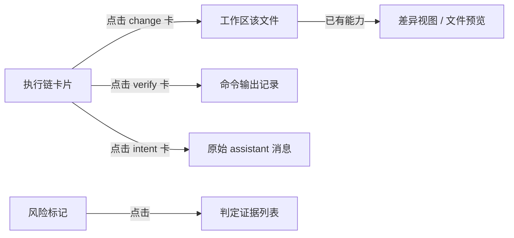
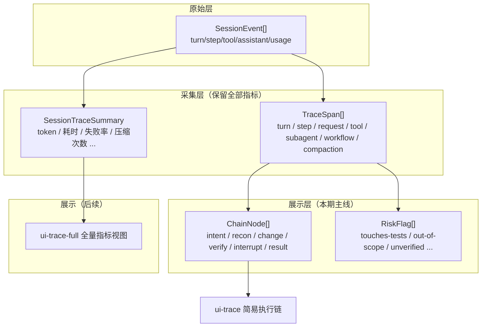
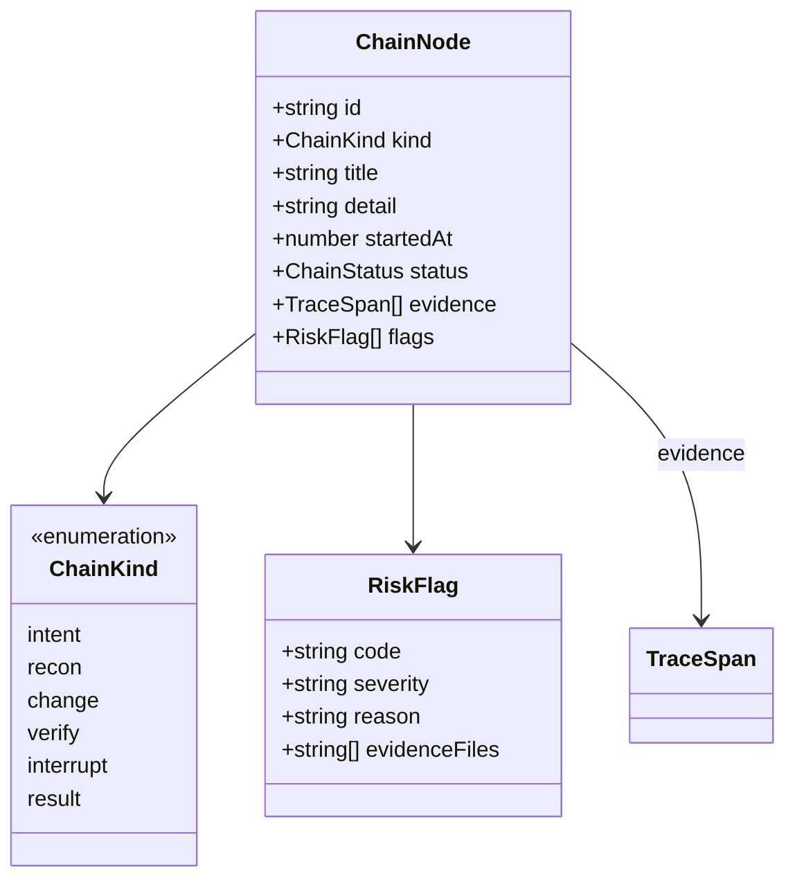
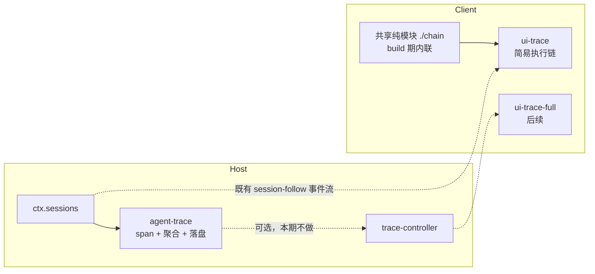
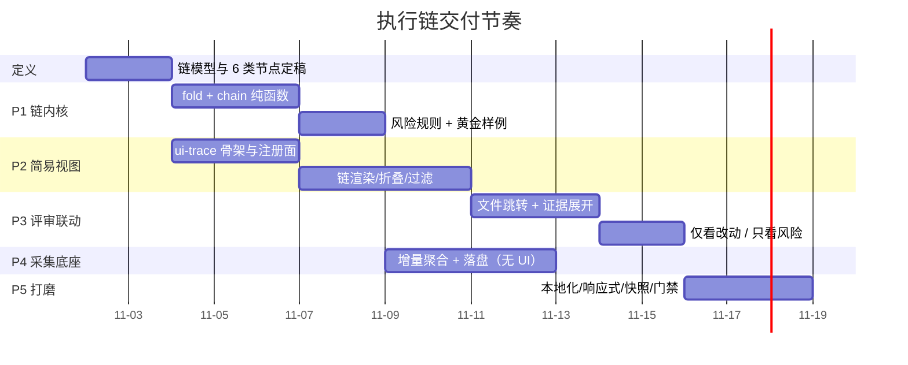

# Agent 执行链可视化 — 架构与执行方案（面向代码评审）

> 目标仓库：`deepseek-harness`（Cordis 全插件式 agent harness）
> 落点：**DSH 内置 Web 插件**（Host 采集 + Client 可视化）
> 本版定位：**简易执行链是当前核心交付**；指标采集保留为底座，全量指标视图后置。

> **实施现状**：链内核已落地为 `packages/review/agent-activity`（`@deepseek-ai/dsh-agent-activity`）——6 类卡片 + 7 条风险规则，44 个测试通过、该包源码 100% 覆盖，`typecheck` / `oxlint` / 文档门禁 21 项全绿。视图层已落地为 `packages/client/ui-agent-chain`（`@deepseek-ai/dsh-client-ui-agent-chain`）：`conversation.view` 标签、6 类卡片、三种筛选、逐卡展开与风险条；P3 评审联动（文件跳转右侧栏预览、依据行跳转轨迹、卡片发布来源 span）已完成，包内 `src/client` 逐文件覆盖率 100%。本文其余部分保留原始规划命名（如 `trace/agent-trace`），以本行为准。

---

## 0. 这一版改了什么

| 维度 | 上一版 | 本版 |
|---|---|---|
| 产品目标 | 单会话时序 + 跨会话行为分析 | **辅助代码评审：让评审员看懂 agent 的思路与编写过程** |
| 首屏内容 | 瀑布图（turn/step/request/tool 全展开） | **一条可读的执行链**（默认 5–15 张卡片，一屏看完） |
| 指标地位 | 主要交付物 | **只采集、不首屏展示**；作为后期"全量视图"的数据源 |
| 交付顺序 | 瀑布 → 看板 | **执行链 → 评审联动 → 采集落盘 → 全量视图** |

采集层的设计（span 模型、增量聚合、`storageDomain` 持久化）**原样保留**，只是排序往后放、UI 不暴露。

---

## 1. 结论先行

1. **评审员拿到的最终产物是 diff**。所以可视化的价值不在"记录了多少"，而在回答三个问题：**它想干什么、它实际干了什么、结果可不可信**。
2. **执行链 = 二次投影**：`SessionEvent[] → Span[]（采集层） → ChainNode[]（展示层）`。Span 保持细粒度，ChainNode 只有 6 类，专为阅读设计。
3. **简易视图只管"读"**：竖向时间线、默认折叠、无图表、无数字看板；单个节点最多一行标题 + 一行对象 + 一个状态点。
4. **指标采集不砍**：Host 侧 `agent-trace` 继续全量聚合落盘，但默认静默；未来的 `ui-trace-full` 直接读它，不需要改采集层。
5. **最容易被误伤的一类改动要主动标出来**：改测试、改 CI/配置、删代码、超出任务范围的改动——这是评审员真正的风险点，比耗时重要得多。

---

## 2. 产品定位：评审场景

### 2.1 评审员的真实动作

拿到 diff 后，评审员依次想知道：

| 顺序 | 问题 | 执行链要给出的答案 |
|---|---|---|
| 1 | 它理解任务了吗 | 首条"意图"卡：它自述的目标 |
| 2 | 它怎么找到要改的地方 | 一组"勘察"卡：读过的文件、搜索过的关键词（合并成一行） |
| 3 | 它为什么这么改 | 每个改动前的"意图"卡（模型自述 + 计划变更） |
| 4 | 它到底改了什么 | "改动"卡：文件、次数、增删行数、是否新增/删除文件 |
| 5 | 它验证过吗 | "验证"卡：跑了什么命令、通过/失败、失败后怎么处理 |
| 6 | 有没有夹带 | **风险标记**：改测试、改配置、超大改动、范围外文件 |

### 2.2 什么不该出现在简易视图里

- 逐条工具参数、逐次 token 数、TTFT、吞吐、p50/p95、跨会话趋势——这些属于全量视图。
- 完整 thinking 原文：默认折叠为一句"意图摘要"，点击可展开（可配置关闭）。
- 中间态噪音：连续 `read`/`grep` 合并展示，不逐条列。

### 2.3 一句话产品定义

> 执行链 = **把一次 agent 会话压缩成 10 来行"人话"**，让评审员在不信任 agent 的前提下，5 分钟内完成"它有没有乱来"的判断，并能一键跳到对应文件。

---

## 3. 简易执行链（核心）

### 3.1 节点类型（只有 6 类）

| 类型 | 图标语义 | 来源（Span / 事件） | 展示内容 | 默认 |
|---|---|---|---|---|
| `intent` 意图 | 💭 它打算做什么 | `assistant/message` 文本首句 + `step/start` 边界；plan 变更时另起一张 | 一句话目标（≤ 60 字，可展开全文） | 展开 |
| `recon` 勘察 | 🔍 它在找什么 | `read`/`grep`/`glob`/`list`/`lsp` 工具 span | "查看了 6 个文件、搜索 3 次" + 展开列表 | 折叠 |
| `change` 改动 | ✏️ 它改了什么 | `write`/`edit`/`str_replace` span + `fs/*` 事件 | 文件路径、修改次数、±行数、新建/删除标记 | 展开 |
| `verify` 验证 | ▶️ 它验证了什么 | `bash`/`test`/`build`/`workflow` span | 命令摘要、通过/失败、耗时（可选隐藏） | 展开 |
| `interrupt` 人工 | 🙋 人介入过 | `approval/request`、`user-questions/request`、用户插话 | "因 X 请求审批，等待 42s" | 展开 |
| `result` 结论 | ✅ 它交付了什么 | `turn/end` + 最终 assistant 文本 | 结论摘要 + 变更文件数 | 展开 |

> 6 类是**展示分类**，不是新的数据源。任何字段都能回溯到原始 span → 原始 session 事件，方便"下钻"与"质疑"。

### 3.2 折叠与合并规则（决定"简单"是否成立）

1. **同类相邻合并**：连续 `recon` 合并为一张卡，展开才逐条列出。
2. **同文件合并**：同一文件的多轮 `change` 合并为一张卡，角标显示 `×3`；展开看到每次改动的意图与时间。
3. **失败不合并**：失败的 `verify` 必须独立成卡，即使相邻同类也**不**折叠——这是评审最关心的信号。
4. **意图按"转折"切分**：模型自述目标发生变化（计划更新、用户插话、失败后改方案）时新起一张 `intent` 卡；否则同一步内不重复出卡。
5. **上限保护**：单会话默认最多渲染 30 张卡；超出按"合并同类"继续压缩，并在底部显示"已压缩 N 次操作"。

### 3.3 评审风险标记（差异化价值所在）

| 标记 | 判定依据 | 展示 |
|---|---|---|
| `touches-tests` | 改动路径命中测试目录/`*.spec.*`/`*.test.*` | 橙色点 + "改了测试" |
| `touches-ci` | 改动命中 CI、构建、lint、权限配置 | 橙色点 + "改了 CI/配置" |
| `deletes` | 删除文件或大段删除（阈值可配） | 红色点 + "删除了 X 行" |
| `out-of-scope` | 改动文件从未在任务描述或首次勘察中出现 | 黄色点 + "范围外文件"（启发式，标注"推断"） |
| `unverified` | 存在 `change` 但整条链无通过的 `verify` | 红色点 + "未验证" |
| `gave-up` | 同一验证连续失败 ≥ 2 次后仍在改动 | 黄色点 + "反复失败后继续修改" |
| `plan-churn` | 会话内计划/todo 变更 ≥ 3 次 | 灰色点 + "方案多次变更" |

这些标记**只附加展示，不改数据**；每一条都要能点开看到判定依据（哪个文件、哪次调用），避免"黑箱告警"。

### 3.4 与最终代码的联动（评审闭环）



- 文件跳转复用既有 `ui-sidebar-files` / 文档预览能力，**不自己实现 diff**。
- 若工作区变更已被 `workspace-changes` 记录，卡片直接显示增删行数；否则显示"改动次数"，不猜行数。
- 后续可选：把执行链导出为 Markdown 附在 PR 描述里（评审沟通用）。

### 3.5 交互与信息密度

- 竖向单列时间线，节点之间用细线连接；不做横向瀑布（横向留白严重、窄屏不可用）。
- 每张卡：`类型点 + 一句话标题 + 目标对象 + 状态`。默认不显示耗时；耗时在展开层，属于"需要时才看"的元数据。
- 顶部只有三个控件：`全部展开/折叠`、`只看风险`、`按文件过滤`。
- 空态：会话未产生改动时，显示"本次未修改代码"，而不是空白。

### 3.6 待定的 UX 决策（需要产品/设计拍板，不阻塞 P1）

1. 是否默认展示 thinking 摘要，还是必须点击展开？
2. 卡片密度：一屏 8 张（宽松）还是 15 张（紧凑）？
3. `recon` 是否默认折叠成一行摘要，还是干脆隐藏（评审往往不关心读文件）？
4. 执行链放在右侧栏 tab，还是作为会话页的一个视图环入口（与 Trajectory 并列）？
5. 是否需要"仅看改动"模式（等价于迷你 diff 导航）。

> 建议默认值：thinking 折叠、密度宽松、`recon` 折叠、右侧栏 tab、提供"仅看改动"。

---

## 4. 两层模型：采集层不变，展示层重做



**关键约束**：`ChainNode` 是 `Span` 的纯函数投影（`chainFromSpans(spans, options)`），不引入新的采集逻辑；这样简易视图与全量视图永远基于同一份事实，不会出现"两个视图数字不一致"。

### 4.1 链节点数据结构



`evidence` 字段是"可质疑"的保证：任何一张卡都能展开到原始 span 与事件序号（`seq`），评审员可以核对而不是相信。

---

## 5. 架构与包结构

| 包 | 角色 | 本期状态 | 职责 |
|---|---|---|---|
| `packages/trace/agent-trace` | 采集 Service + 内置 Provider | **做（P1、P4）** | span 折叠、增量聚合、`storageDomain` 落盘、`sessionQuery` 回填；导出浏览器安全的 `./fold`、`./chain` 纯子路径 |
| `packages/client/ui-trace` | 简易执行链 UI | **做（P2、P3）** | 链渲染、折叠、风险标记、文件跳转；不引入图表库 |
| `packages/api/trace-controller` | Typert Remote | **本期不做** | 只有"跨会话全量视图"需要它；简易视图走既有会话事件流，不需要 Remote |
| `packages/client/ui-trace-full` | 全量指标视图 | **后续** | 瀑布、趋势、排行；读 `agent-trace` 聚合与 Remote |



> 与上一版一致：视图走既有会话事件流，**不依赖 Typert 生成链路**，所以简易视图可以最早独立上线。

### 5.1 包内文件

```text
packages/trace/agent-trace/
  src/fold.ts      # SessionEvent[] → Span[]（确定性、可单测）
  src/chain.ts     # Span[] → ChainNode[]（本期新增，展示投影）
  src/risk.ts      # ChainNode[] → RiskFlag[]（规则可配）
  src/aggregate.ts # 增量聚合（保留，本期不接 UI）
  src/store.ts     # storageDomain 落盘（P4）
packages/client/ui-trace/
  src/client/index.ts        # apply：注册右侧栏 tab 类型
  src/client/chain/          # 链渲染、折叠、过滤
  src/client/locale/{en,zh}.json
```

---

## 6. 执行计划（重排）



### P0 链模型定稿（2d）

- 定 6 类节点的边界与合并规则；用 3 个真实会话样本手工画一遍目标产物（纸面原型）。
- 拍板第 3.6 节的 5 个 UX 问题（至少定默认值）。
- **验收**：3 个样本都能用 ≤ 15 张卡讲清楚，评审员不看 diff 也能复述"它干了什么"。

### P1 链内核（5d）

- `fold.ts` 复用上一版设计（确定性 span 折叠）。
- `chain.ts`：span → 6 类节点，含合并/切分规则；纯函数，无 IO。
- `risk.ts`：7 条规则，逐条可单测；`out-of-scope` 标注为启发式。
- **验收**：黄金样例逐字比对（卡片标题/顺序/角标）；10k 事件折叠 + 成链 < 80ms。

### P2 简易视图（7d）

- 三个注册面：`tsconfig.client.json` reference、`packages/bundle/web-app/cordis.patch.yml` row、`web-app/package.json` 依赖；`dsh.client` 清单 + `./client` 导出。
- 右侧栏 tab 类型注册（`ctx.sidebarRightTabs`）；链渲染、展开折叠、三种过滤。
- **验收**：`test:gui` 绿；窄屏 375px 不横向滚动；一屏 8 张卡时可读性走查通过。

### P3 评审联动（5d）

- 文件跳转到既有文件视图/预览；证据展开显示原始 span + `seq`。
- "仅看改动""只看风险"两个模式。
- **验收**：任意卡片 2 次点击内到达对应文件或事件。

### P4 采集底座（4d）

- 增量聚合 + `storageDomain` 落盘 + `sessionQuery` 回填，**不接任何 UI**。
- **验收**：增量 == 全量（属性测试）；落盘对事件循环无可观测影响（分片）。

### P5 打磨与门禁（3d）

- i18n 字典、`--dsw-*` 主题 token、快照、README（含 Model Experience / Known Limitations）、`docs/subsystems/` 页面、Agent Note 记录"两层投影"决策。

---

## 7. 测试与验收

| 层级 | 内容 | 命令 |
|---|---|---|
| 单元 | `fold` 确定性；`chain` 合并/切分规则；7 条风险规则各自正反例 | `pnpm run test` |
| 快照 | 3 个真实录制会话 → 链的稳定输出（标题/顺序/标记） | 仓库快照机制 |
| 组件 | 折叠、过滤、空态、窄屏、键盘可达 | `pnpm run test:gui` |
| 端到端 | 回放会话，浏览器可见输出 | `DSH_SNAPSHOT=replay pnpm run test:web` |
| 覆盖率 | Client 源文件 100% | `pnpm run test:coverage` |
| 构建/文档 | 双 face、包约束、文档门禁 | `build:check`、`hygiene`、`doc-sync` |

**可读性验收（非机器门禁，人工走查）**：抽 5 个真实会话，让未参与开发的同事只看执行链，回答"它改了什么、为什么、验证了吗"——3 题全对才算通过。

---

## 8. 风险与对策

| 风险 | 对策 |
|---|---|
| 链退化成"第二个 Trajectory" | 硬性约束：默认 ≤ 15 张卡、无图表、每条目一句话；明细一律进展开层 |
| 风险标记误报引发不信任 | 每条标记可点开看依据；`out-of-scope` 明确标注"启发式推断"；阈值走 `Config` |
| thinking 内容敏感/噪声 | 默认只显示一句摘要，原文折叠；可在设置里关闭 |
| 合并过度导致关键步骤消失 | 失败卡与人工介入卡**永不合并**；提供"全部展开" |
| 与 diff 对不上 | 文件卡只显示能确证的字段；行数缺失时显示"改动次数"而非猜测 |
| 以后加全量视图要重做采集 | 采集层先行（P4 独立交付），链与全量视图共用 span |

---

## 9. 指标采集的保留策略（为全量视图预留）

- **采集范围不变**：turn/step/request/tool/subagent/workflow/compaction/审批等待全部继续折叠与聚合。
- **默认静默**：不接 UI、不打日志噪音、落盘有界（保留期与条数走 `Config`）。
- **接口预留**：`agent-trace` 暴露 `sessionTrace(sessionId)` 与 `sessionSummary(sessionId)`；未来的 `ui-trace-full` 与 `trace-controller` 直接消费，不改采集层。
- **版本字段**：聚合记录保留 `traceVersion`，采集语义变化时失效重算。

---

## 10. 待决清单（下次评审前需要答案）

1. 3.6 节 5 个 UX 问题的最终取值。
2. 简易视图入口：右侧栏 tab（建议）vs 会话视图环。
3. 风险标记的默认严重度分级（哪些直接标红）。
4. 是否需要"执行链导出 Markdown 附 PR"作为第一次迭代的附加项。
5. 包名：简易视图叫 `client/ui-agent-chain`（职责直白，推荐）还是沿用 `ui-trace`（为将来 `ui-trace-full` 留命名空间）——本文暂用 `ui-trace`。

---

## 11. 速查

- 本期只做 **3 件事**：链内核（`chain.ts` + `risk.ts`）、简易视图（`ui-trace`）、评审联动（文件/证据跳转）。
- 指标采集**照做**，但不进首屏、不接 UI。
- 不新增 Session 事件类型，不改 `agent-loop`，简易视图不依赖 Typert Remote。
- 成功标准：评审员看 15 张卡，能回答"改了什么 / 为什么 / 验证了吗"，并 2 次点击内核对到代码。
