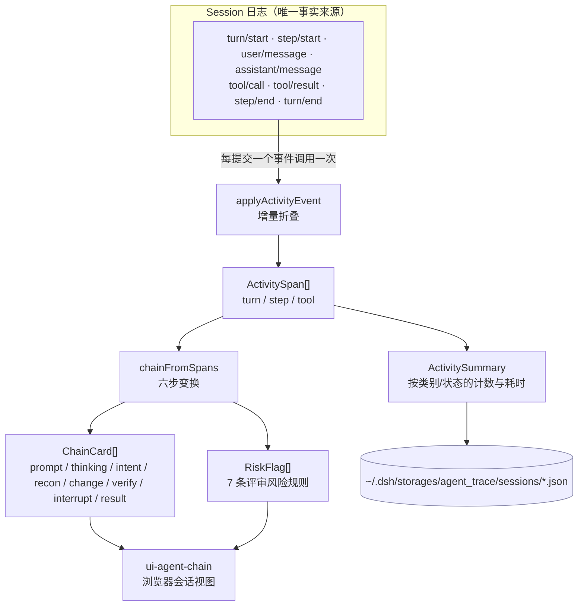
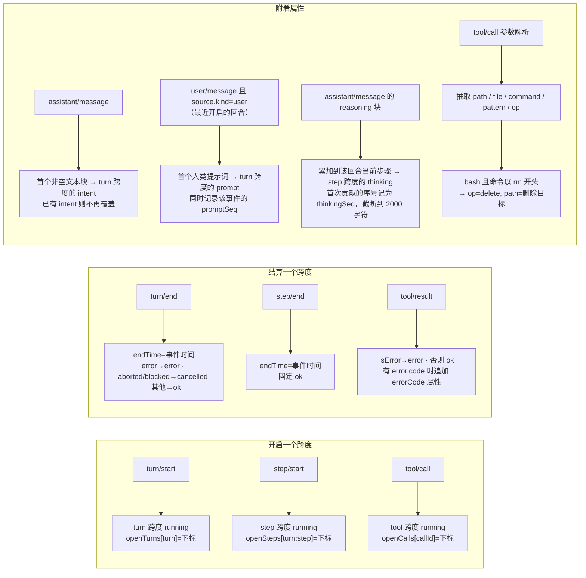
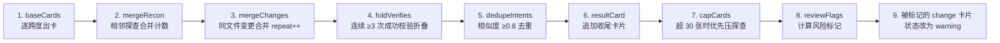
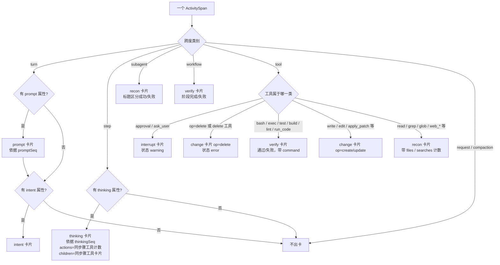
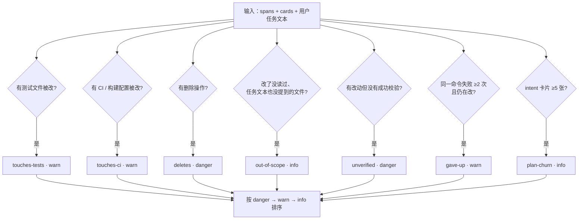
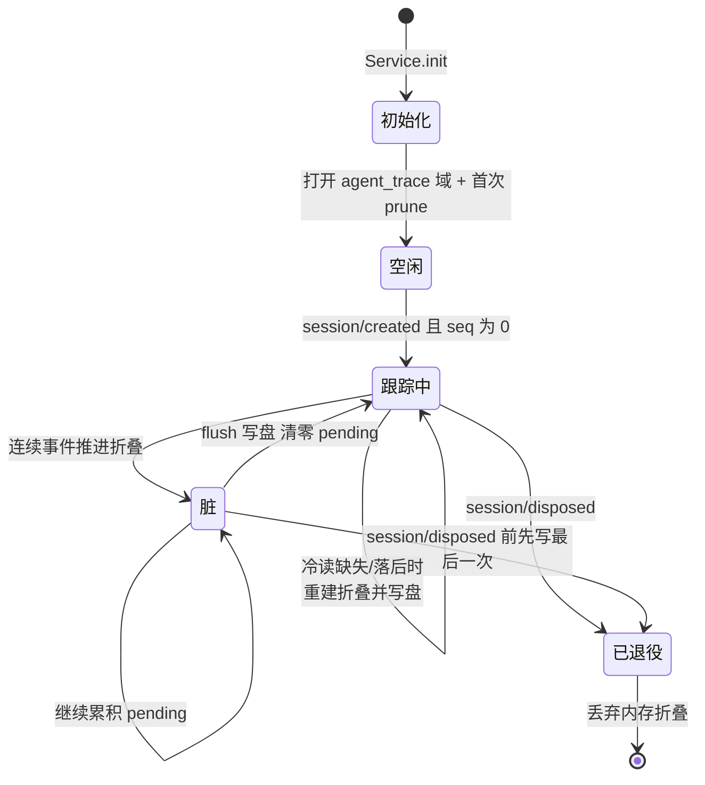
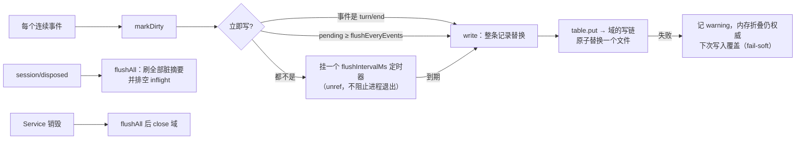
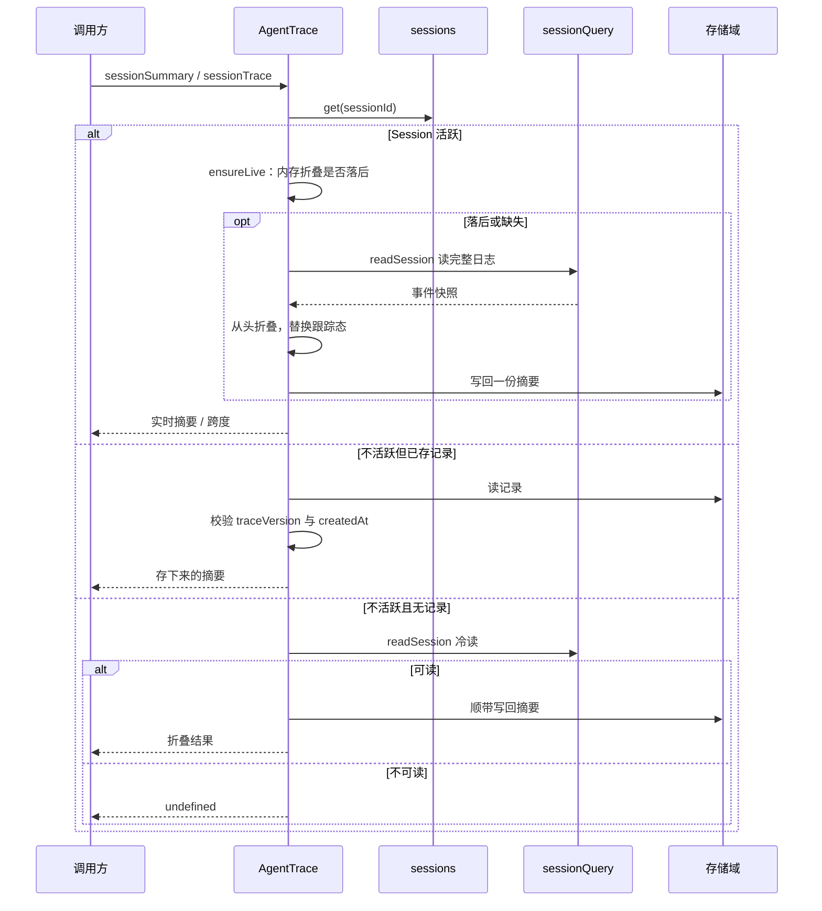
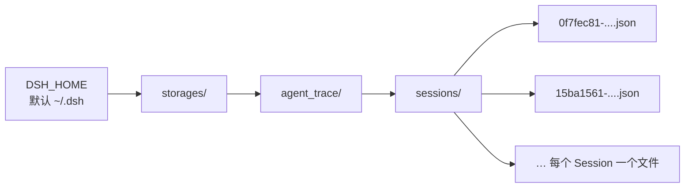
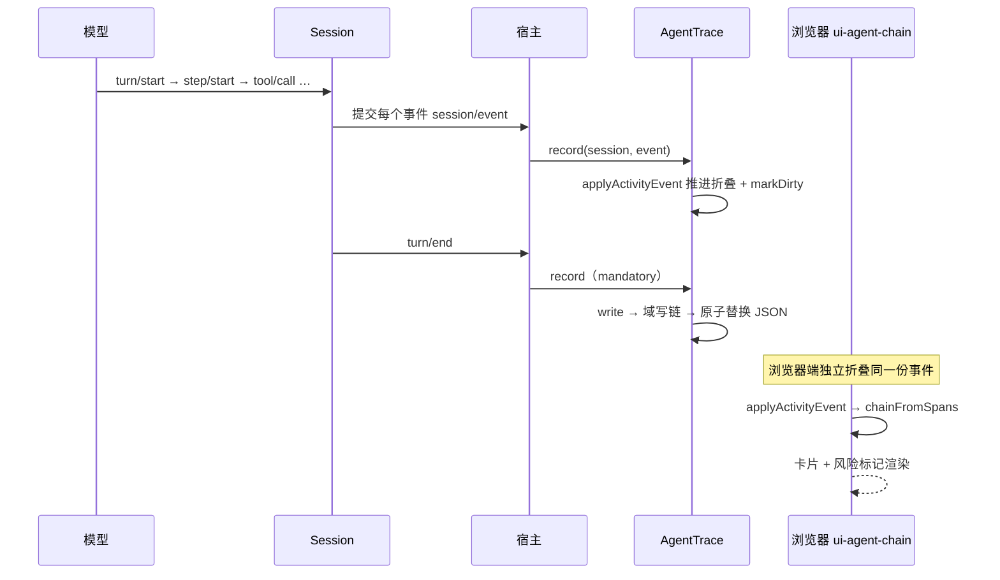

# 评审双模块工作流程（agent-activity / agent-trace）

> 本文档用 Mermaid 梳理 `packages/review` 下两个包的数据流、状态机与落盘位置。
> 源码依据：`packages/review/agent-activity/src`、`packages/review/agent-trace/src`。

## 0. 一图看懂

一句话：**agent-activity 是纯函数投影库（事件→跨度→卡片/风险），agent-trace 是宿主侧采集服务（同一份跨度→计数→持久化）。**



关键点：`ui-agent-chain` 在**浏览器**里自己折叠，读的是 `agent-activity`；`agent-trace` 在**宿主**里折叠出计数并落盘，目前还没有读取方。

---

## 1. 阶段一：事件 → 跨度（fold）

`applyActivityEvent(state, event)` 是唯一的状态推进函数，`foldActivity(events)` 只是对整份日志循环调用它。



设计约束：

- **非破坏性更新**：函数永不修改入参，未改变的状態返回同一引用（上层可直接用引用比较短路重渲染）。
- **迟到事件不补**：`turn/end`、`step/end`、`tool/result` 找不到对应的开启记录时直接返回原状态，不凭空造跨度。
- **提示词挂在回合、思考挂在步骤**：`user/message` 不携带回合编号，因此记到最近开启的回合；合成注入（插件上下文、召回历史、目标续跑）不是人类提示词，不记录。思考记到 `assistant/message` 自带的 turn/step；步骤未开启时丢弃。同一事件同时推进回合的 `intent` 与步骤的 `thinking`。
- **只有三类跨度会产出**：`request`、`subagent`、`workflow`、`compaction` 在类型里存在，当前 folder 从不产出，计数恒为 0。
- **`seq` 是跨度身份**：每个跨度记录它开启时的会话事件序号，是后续"证据回溯"的锚点。

---

## 2. 阶段二：跨度 → 卡片（chainFromSpans）



### 2.1 分类规则（第 1 步）



> 顺序很重要：删除要先于执行类判断，否则 `bash rm` 会被误读成一次校验。

### 2.2 合并语义（第 2–7 步）

| 步骤 | 规则 | 为什么 |
|---|---|---|
| `mergeRecon` | 只合并**相邻**且都来自工具的探查卡片；子代理交接不参与 | 一次连续翻文件是"看了一圈"，分散在两头则是两个阶段 |
| `mergeChanges` | 同一路径的变更卡片合并为一张，`repeat` 累加，位置保留首次编辑处 | 评审者关心"这个文件被改了"，不是被改了几次 |
| `foldVerifies` | 连续成功的校验 ≥3 次折成一张 `verifyRun`；**失败校验永远独立保留** | 失败是评审信号，折叠会掩盖它 |
| `dedupeIntents` | 与上一个 intent 相似度 ≥0.8 时合并，除非中间隔了中断或失败校验 | 模型反复复述同一个计划不是新计划 |
| `resultCard` | 汇总变更文件数、校验次数；有改动但无成功校验时状态为 error | 给整条链一个结论 |
| `capCards` | 超过 30 张时，反复合并最前面的两张探查卡片 | 只压探查，因为压掉不同文件的变更会藏住必须看的东西 |

> 合并按层进行：顶层卡片合成一层，每张思考卡片的 `children` 再各自合成一层。思考卡片不参与任何合并，并且会把相邻勘察卡隔开：每个步骤的行动子卡各自成层，这正是"思考 + 行动"要表达的配对关系；同一文件在两个步骤里各改一次就是两张子卡，因为卡片属于促成它的那段思考。

### 2.3 卡片契约

- **标题是消息描述符，不是文案**：`prompt` 是用户原话、`thinking` 是模型思考首句、`intent` 是模型原话（都截断到 60 字符），其余只描述"用哪条文案 + 插值什么值"，具体语言由 UI 查自己的字典 → 投影层永不产生产品文案。
- **`evidenceSeqs`**：每张卡片记录它由哪些会话事件序号构成，评审者可以点开回原始事件；`prompt` 卡片依据写下它的那条 `user/message`，`thinking` 卡片依据它展示思考的那条 `assistant/message`。
- **`actions`**：思考卡片用 `ChainActions`（files / searches / changes / verifications 计数）描述同一步骤触发的行动，供 UI 组合成一行摘要。
- **`children`**：同一步骤的工具调用成为该思考卡片的子卡，按事件顺序排列并以缩进子卡渲染；没有记录思考的步骤，工具卡片留在顶层平铺。结果卡与风险规则统计的是展开后的全部卡片，因此子卡里的改动同样计入文件数与风险标记。
- **`diffs`**：改动卡片可携带 `ChainDiff`（path / oldText / newText，记录时变更前后的原文），由 `chainFromSpans(spans, userText?, diffs?)` 的第三项按工具调用标识传入——跨度只记录调用标识，不记录它改过的文件文本。投影只挂载、不计算补丁；同一文件的多次改动合并时差异块按顺序拼接，行级补丁由 UI 的 `DiffBlock` 派生。
- **`meta`**：同一事实的机器可读副本，供展开视图与风险规则使用；用户提示词全文放在 `prompt` 卡片的 `meta.prompt`，步骤的思考原文放在 `thinking` 卡片的 `meta.thinking`。
- **提示词、思考与意图都不参与合并**：`prompt` 卡片按回合出现一次，`thinking` 卡片按步骤出现一次，`dedupeIntents` 只合并相似意图——每句人类要求和每步思考都是独立事实。

---

## 3. 阶段三：风险标记（reviewFlags）



最后一步只把**被标记的 `change` 卡片**（不含 `unverified`）状态改成 `warning`，底层跨度不变——标记是视图层信息，不改写事实。

---

## 4. agent-trace：采集服务生命周期



### 4.1 写触发条件



### 4.2 读路径



### 4.3 两道版本护栏

| 字段 | 绑定对象 | 不符时的处理 |
|---|---|---|
| `traceVersion` | 折叠语义版本 `ACTIVITY_TRACE_VERSION` | 记录视为不存在，重新计算 |
| `createdAt` | Session 生命周期的创建时间 | 判定为"同一 id 的前世"，删除旧记录而不是对外服务 |

---

## 5. 落盘位置与文件结构



```
~/.dsh/storages/agent_trace/sessions/<sessionId>.json
```

```json
{
  "version": 1,
  "record": {
    "traceVersion": 1,
    "createdAt": 1794294733745,
    "asOfSeq": 199,
    "updatedAt": 1794294800000,
    "summary": {
      "spansByKind": { "turn": 3, "step": 12, "tool": 28, "request": 0, "subagent": 0, "workflow": 0, "compaction": 0 },
      "spansByStatus": { "running": 0, "ok": 40, "error": 1, "cancelled": 0, "interrupted": 0 },
      "durationByKind": { "turn": 183000, "step": 90000, "tool": 42000, "request": 0, "subagent": 0, "workflow": 0, "compaction": 0 }
    }
  }
}
```

- `per-record` 布局：一次 flush 只原子重写**一个**文件，不重写整表。
- 目录**惰性创建**：`open()` 不碰磁盘，首次写入才 `mkdir`。
- 保留策略：`retentionDays`（默认 30 天）与 `maxRecords`（默认 500 条）在域打开时、以及出现新 Session id 时清理。

---

## 6. 端到端：一次任务从产生到展示



---

## 7. 现状与边界

| 事实 | 影响 |
|---|---|
| 卡片链在浏览器折叠 | 宿主侧的 `agent-trace` 计数暂时"存而不用" |
| `agent-trace` 无消费者 | 完整 trace 视图尚未实现，`sessionSummary` / `sessionTrace` 无人调用 |
| 只折叠 turn / step / tool | `request`、`subagent`、`workflow`、`compaction` 计数恒为 0 |
| 提示词挂在回合、思考挂在步骤 | 不新增跨度类别，计数与摘要格式不变；冷读日志同样能折出它们 |
| 从日志折出来的链不含审批、子代理交接、工作流阶段 | 这些是活 Cordis 事件，不是 Session 记录 |
| 冷 trace 每次重读日志 | 存储只留摘要，不留跨度 |
| `out-of-scope` 是启发式 | 与"读过的路径"和任务文本（调用方传入，或链中记录的提示词）比对，属于推断而非事实 |
